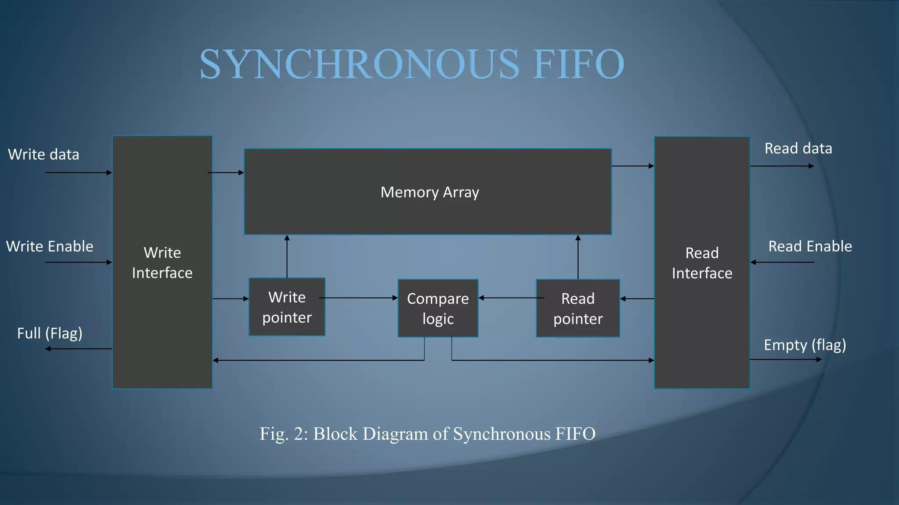

# Synchronous FIFO: Design & SystemVerilog Verification

A parameterized synchronous FIFO written in Verilog, verified with a class-based SystemVerilog testbench. The testbench has a generator, driver, monitor, a scoreboard with a queue-based reference model, and SystemVerilog Assertions (SVA).



**Result:** 14/14 test cases pass, with 272 samples checked and 0 errors (Vivado xsim 2022.2). See [docs/sim_output.log](docs/sim_output.log).

---

## Repository structure

```
FIFO-Verification/
├── rtl/
│   └── design.v            # Synchronous FIFO (DUT)
├── testbench/
│   └── testbench.sv        # Class-based SV testbench + SVA
├── scripts/
│   ├── run_xsim.sh         # Vivado xsim (Linux / Git Bash)
│   └── run_xsim.bat        # Vivado xsim (Windows)
├── docs/
│   ├── fifo_architecture.jpg
│   └── sim_output.log      # Reference simulation output
└── sim/                    # Simulator working directory (git-ignored)
```

---

## Design (`rtl/design.v`)

| Parameter | Default | Description            |
|-----------|---------|------------------------|
| `width`   | 32      | Data width in bits     |
| `depth`   | 128     | Number of FIFO entries |

| Port    | Dir | Width   | Description                                      |
|---------|-----|---------|--------------------------------------------------|
| `clk`   | in  | 1       | Clock (rising edge)                              |
| `rstn`  | in  | 1       | Asynchronous active-low reset                    |
| `en`    | in  | 1       | Global enable. No read or write occurs when it is low. |
| `wr_en` | in  | 1       | Write request                                    |
| `rd_en` | in  | 1       | Read request                                     |
| `din`   | in  | `width` | Write data                                       |
| `dout`  | out | `width` | Registered read data                             |
| `full`  | out | 1       | FIFO holds `depth` entries                       |
| `empty` | out | 1       | FIFO holds no entries                            |

**How it works**

- **Memory:** a `depth × width` register array.
- **Pointers:** separate write and read pointers that wrap from `depth-1` back to `0`, so any depth works, not only powers of two.
- **Occupancy counter:** `full` and `empty` are decoded from a `$clog2(depth+1)`-bit count.
- **Protection:** a write is ignored when the FIFO is full, and a read is ignored when it is empty.
- **Simultaneous read and write:** both happen in the same cycle and the count stays the same.
- **Read latency:** `dout` is registered, so data appears one clock after an accepted read and holds its value otherwise.
- **Reset:** clears the pointers, the count, and `dout`.

---

## Testbench architecture (`testbench/testbench.sv`)

```
 ┌───────────┐  mailbox  ┌────────┐   intf.DRV   ┌───────┐   intf.MON   ┌─────────┐  mailbox  ┌────────────┐
 │ Generator │ ────────► │ Driver │ ───────────► │  DUT  │ ───────────► │ Monitor │ ────────► │ Scoreboard │
 └───────────┘           └────────┘              └───────┘              └─────────┘           │ (queue ref │
       ▲    drv_done event   │                       ▲                                        │   model)   │
       └─────────────────────┘                  SVA checkers                                  └────────────┘
                                               (in interface)
```

| Component          | Role                                                                                         |
|--------------------|----------------------------------------------------------------------------------------------|
| `transaction_item` | Holds the stimulus and the sampled response, plus a case label                               |
| `intf`             | Clocking blocks (driver drives on `negedge`, monitor samples after `posedge`), modports, and the SVA properties |
| `generator`        | Produces the directed scenarios. Each scenario is handed to the driver and the generator waits for it to finish |
| `driver`           | Drives one transaction per clock through `driver_cb`                                          |
| `monitor`          | Samples the DUT pins 1 ns after each rising edge                                             |
| `scoreboard`       | A SystemVerilog queue models the FIFO. It checks `dout`, `full` and `empty` on every sample and reports PASS/FAIL per case |
| `environment` / `test` | Build the components, run them, and print the final summary                              |

### Test cases

| # | Case                      | Checks                                                        |
|---|---------------------------|---------------------------------------------------------------|
| 1 | `RESET`                   | `dout = 0`, `empty = 1`, `full = 0` after reset               |
| 2 | `SINGLE_WRITE` / `SINGLE_READ` | Basic data integrity                                     |
| 3 | `FILL_TO_FULL`            | 128 writes, and `full` asserts exactly at `depth`             |
| 4 | `WRITE_WHILE_FULL`        | An overflow write is rejected and the data is not corrupted   |
| 5 | `DRAIN_FIFO`              | 128 reads come out in FIFO order, and `empty` asserts         |
| 6 | `READ_WHILE_EMPTY`        | An underflow read is rejected and `dout` holds                |
| 7 | `DISABLE_HOLDS_FIFO`      | With `en = 0`, write requests are ignored                     |
| 8 | `IDLE_HOLD`               | No request leaves the outputs and flags stable                |
| 9 | `SIMULTANEOUS_*`          | A read and a write in the same cycle at non-zero occupancy, followed by a drain |

### Assertions (SVA)

| Assertion                   | Property                                              |
|-----------------------------|-------------------------------------------------------|
| `a_reset_check`             | Reset clears `dout` and sets the flags to empty        |
| `a_no_unknowns`             | No X or Z on `dout`, `full` or `empty` outside reset  |
| `a_full_empty_exclusive`    | `full` and `empty` are never both high                |
| `a_reject_write_when_full`  | A write-only request while full keeps the FIFO full   |
| `a_reject_read_when_empty`  | A read-only request while empty keeps the FIFO empty  |
| `a_dout_holds_without_read` | `dout` is stable when no read is accepted             |
| `a_dout_read_activity`      | `dout` is known after an accepted read                |

---

## Running the simulation

The project targets **Vivado xsim** (tested with Vivado 2022.2), which supports the SystemVerilog classes, mailboxes, queues and SVA that the testbench uses.

First add Vivado's `bin` directory to your PATH, for example by running `settings64.sh` or `settings64.bat`.

```bash
# Linux / Git Bash
./scripts/run_xsim.sh
```

```bat
:: Windows cmd
scripts\run_xsim.bat
```

The scripts compile into `sim/` and write the log to `sim/sim.log`. To view waveforms, open `sim/tb_sim.wdb` in the Vivado GUI, or run `xsim tb_sim -gui` from inside `sim/`.

### Expected output

```
  PASS: RESET
  PASS: SINGLE_WRITE
  ...
  PASS: SIMULTANEOUS_DRAIN

========== FIFO SCOREBOARD ==========
Samples checked : 272
Errors          : 0
Cases passed    : 14
Cases failed    : 0
OVERALL RESULT: PASS
====================================
```

---

## Possible extensions

- Constrained-random stimulus with functional coverage (`covergroup` on occupancy and on read/write combinations)
- A UVM version of the environment
- An asynchronous (dual-clock) FIFO with Gray-code pointers
